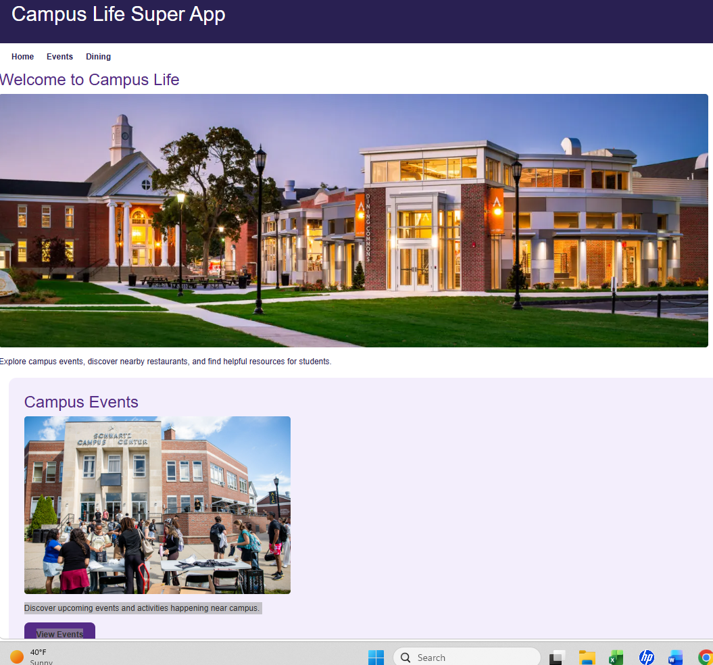

# Campus Life Super App

## Project Description
Campus Life Super App is a student-friendly website designed to help college students find campus events, explore dining options, and access helpful resources in one place.

This project was created for my Web Development course at American International College.

## Technologies Used
- HTML5
- CSS3
- Bootstrap 5
- JavaScript
- Ticketmaster Discovery API
- Geoapify Places API
- Git and GitHub
- GitHub Pages

## Website Features

### Home Page
Introduces the Campus Life Super App and provides navigation to the Events and Dining pages.

### Events Page
The Events page allows users to search for upcoming events by city using the Ticketmaster Discovery API. Event names, dates, and links are displayed dynamically using JavaScript.

### Dining Page
Allows users to select a Springfield-area college and search for nearby restaurants and cafés. The Dining page uses the Geoapify Places API to display nearby dining locations.

## Project Screenshots
### Home Page

## How to Use the Website
1. Open the website using the GitHub Pages link.
2. Select Home, Events, or Dining from the navigation menu.
3. On the Events page, enter a city to search for events.
4. On the Dining page, choose a college and click Find Dining.

The Events and Dining pages use APIs to display live search results.

## Setup Instructions
1. Download or clone this GitHub repository.
2. Open the project folder in Visual Studio Code.
3. Open `index.html` in a web browser.
4. Navigate between the three pages.

The Events API requires a valid Ticketmaster Consumer Key.

The Dining page uses the Geoapify Places API and requires a valid Geoapify API key.

## Deployment
This website is hosted using GitHub Pages.

Website: https://albano277.github.io/campus-life-super-app/

GitHub Repository: https://github.com/Albano277/campus-life-super-app

## Future Improvements
- Add event categories and additional search filters.
- Expand student resources to include tutoring, career services, and additional campus support links.
- Add restaurant details such as addresses and opening hours.
- Improve accessibility and mobile responsiveness.
- Add more helpful student resources.

## Troubleshooting

- If events do not appear, check that a valid city was entered and that the Ticketmaster API is responding.
- If dining locations do not appear, select a college and try the search again. Results depend on the Geoapify Places API.
- If the website does not load correctly, refresh the page and check your internet connection.
- If images or styling are missing, verify that the file paths match the files in the project.

## Image Credits

- American International College (AIC): Campus photographs used with permission for this educational project.
- OpenAI ChatGPT: AI-generated images created for the Campus Dining and Student Resources sections.
- AIC Library and Academic Support: Official college webpages linked as student resources.

## Author
Maria Albano

Web Development — American International College

October 2026
